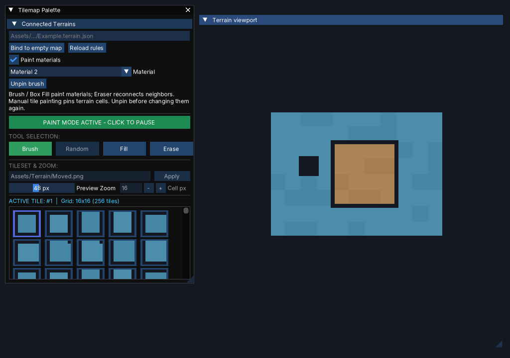

# Engine2D

**A C++ 2D game engine with a visual editor and a separate standalone runtime.**

Engine2D explores the systems behind a game development workflow: rendering, entities and components, scene editing, scripting, and asset management. The engine and editor live in this repository; game projects keep their own content and settings in a separate workspace.



*Terrain palette and viewport from an editor validation scene.*

## Features

- SDL3 GPU rendering, 2D lighting, materials, post-processing, particles, and trails.
- An entity-component system with scene serialization, prefabs, and asset handles.
- A visual editor with hierarchy, inspector, asset browser, and authoring panels.
- Tilemap, terrain, texture composition, animation, and UI authoring tools.
- Scripting and EngineScript tooling, including a VS Code extension.
- A Project Hub for creating and opening separate game projects.
- Standalone runtime packaging and automated integrity tests.

## Technology

`C++20` · `SDL3` · `Dear ImGui` · `GLM` · `CMake`

## Build and run

The documented CI build runs on macOS. Install a C++20 compiler and the build dependencies; CMake 3.20+ and SDL3 3.4+ are required.

```sh
brew install cmake sdl3 glm curl
cmake -S . -B build -DCMAKE_BUILD_TYPE=Debug
cmake --build build --parallel 3
./build/Engine2D
```

Launching without arguments opens the Project Hub. Create a new project there, or open an existing directory containing `project.engine2d`, `Assets/`, and `ProjectSettings/`.

To work with a specific project:

```sh
cmake -S . -B build -DENGINE_PROJECT_DIR=/absolute/path/to/GameProject
cmake --build build --parallel 3
./build/Engine2D --project /absolute/path/to/GameProject --editor
```

CMake builds the pinned shader compilation toolchain when no prebuilt `ENGINE_SHADERCROSS_EXECUTABLE` is supplied. The first build needs network access and can take longer.

## Tests

```sh
ctest --test-dir build --output-on-failure
```

Tests cover engine systems, serialization, assets, editor workflows, and runtime contracts. GPU tests are opt-in with `-DENGINE_ENABLE_HARDWARE_TESTS=ON` and require a native graphics device. The [integrity workflow](.github/workflows/engine-integrity.yml) defines the isolated CI fixture and build configuration.

## Documentation

| Area | Guide |
| --- | --- |
| Projects, editor launch, and export | [Project layout](docs/PROJECTS.md) |
| Rendering and materials | [Render materials](docs/RENDER_MATERIALS.md) |
| Scripting | [Scripting](docs/SCRIPTING.md) and [EngineScript API](docs/ENGINESCRIPT_API.md) |
| Terrain and level authoring | [Surface generator](docs/SURFACE_GENERATOR.md) and [Level composer](docs/LEVEL_COMPOSER.md) |
| Texture and VFX tools | [Texture composer](docs/TEXTURE_COMPOSER.md) and [VFX preview](docs/VFX_PREVIEW.md) |
| Development plans | [Roadmap](ROADMAP.md) |

Engine2D is under active development. See the guides and roadmap for the current scope of each system.
