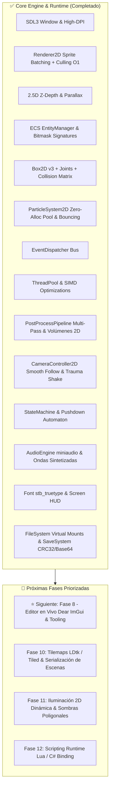

# 🗺️ Roadmap de Desarrollo - Motor de Juegos C++ 2D / 2.5D

Este documento define la hoja de ruta técnica para hacer evolucionar el motor hacia un motor de videojuegos 2D/2.5D modular, de alto rendimiento y listo para producción.

---

## 📊 Estado Actual de la Arquitectura

---

## 🏆 Fases Completadas

### 📍 Fase 1: Carga de Assets & Renderizado 2.5D
- [x] **Cargador de Imágenes Reales (`stb_image`)**: Carga de `.png`, `.jpg`, `.bmp`, `.tga` a texturas GPU.
- [x] **Sprite Sheets y Animaciones 2D**: `SpriteSheet` y `Animation2D` con control de FPS, clips y bucles.
- [x] **Cámara 2.5D & Parallax**: Profundidad $Z$, escalado focal y desplazamiento de capas de fondo.

### 📍 Fase 2: Optimizaciones de Rendimiento Extremo
- [x] **Sprite Batching**: Agrupación de quads por textura vía `SDL_RenderGeometry` (1 sola Draw Call por frame).
- [x] **Frustum Culling 2D**: Descarte en $O(1)$ (`Camera2D::is_visible`) para objetos fuera del viewport.
- [x] **Gestor de Recursos (`AssetManager`)**: Caché centralizada para evitar duplicación en RAM/VRAM.
- [x] **Vectorización SIMD & Multihilo**: Aceleración ARM NEON / SSE2 y batching paralelo con `ThreadPool`.

### 📍 Fase 3: Arquitectura ECS & Bus de Eventos
- [x] **Sistema de Entidades & Componentes (`EntityManager`)**: Firmas bitmask de 64 bits, vistas de exclusión, hooks de ciclo de vida (`on_construct`, `on_destroy`).
- [x] **Bus de Eventos (`EventDispatcher`)**: Comunicación desacoplada síncrona y diferida por fotograma.
- [x] **Mapeo de Controles (`InputManager`)**: Teclado, ratón y proyección de puntero a coordenadas de mundo.

### 📍 Fase 4: Físicas 2D, Joints & Sistema de Partículas
- [x] **Física Box2D v3 Integrada (`PhysicsSystem`)**: Cuerpos estáticos/dinámicos, fricción, restitución y raycasts.
- [x] **Matriz de Capas de Colisión**: Bitmasking por categorías (`PLAYER`, `GROUND`, `COIN`, `HAZARD`, `PROJECTILE`).
- [x] **Articulaciones & Cuerdas Elásticas**: Soporte de `JointType::Rope` con deformación de catenaria por curvas de Bézier.
- [x] **Motor de Partículas Nativo (`ParticleSystem2D`)**: Pool circular de cero asignaciones en memoria, rebote físico contra el terreno y texturas procedurales suaves (soft-circle y diamond-spark).
- [x] **Presets Desacoplados (`Engine::Presets`)**: Recetas de gameplay (explosiones, chispas, monedas, polvo) aisladas del núcleo del motor en `src/particles/ParticlePresets.hpp`.

### 📍 Fase 5: Pipeline Visual, Shaders & Post-Processing
- [x] **Texturas Procedurales Parametrizadas (`ProceduralTextureDesc`)**: Generación matemática (`NoiseGradient` Simplex/Perlin fBm, `Voronoi`, degradados y patrones).
- [x] **Pipeline de Post-Processing (`PostProcessPipeline`)**: Render targets auxiliares, pases modulares (`Bloom`, `GaussianBlur`, `ChromaticAberration`, `Vignette`, `ColorGrading LUT`, `FilmGrain`, `ScanlinesCRT`, `ScreenFlash`).
- [x] **Mip-chain & Downsampling**: Render targets a 1/2 y 1/4 de resolución para optimización de efectos intensivos.
- [x] **Volúmenes de Post-Proceso 2D (`PostProcessVolume`)**: Triggers de escena con interpolación suave (*lerp/blend*) al entrar a zonas climáticas/atmosféricas.
- [x] **Sistema de Tweens & Event FX**: Interpoladores con curvas de easing para destellos, transiciones y efectos visuales reactivos.

### 📍 Fase 6: Game Feel, Tiempo & Cámara Cinemática
- [x] **Gestión de Tiempo Global (`Engine::Time`)**: Escala de tiempo para pausa limpia, *Bullet Time* / cámara lenta, y clamping contra caídas de framerate.
- [x] **Renderizado en Espacio de Pantalla (`Screen-Space Canvas / HUD`)**: Ordenamiento prioritario (`submit_screen_sprite`, `submit_screen_text`) desacoplado de la cámara.
- [x] **Controlador de Cámara Cinemático (`CameraController2D`)**: *SmoothDamp Follow*, *Deadzone*, *Lookahead* direccional, límites de mapa AABB y *Trauma Screen Shake* no lineal cuadrático.

### 📍 Fase 7: Arquitectura de Gameplay & Máquinas de Estado
- [x] **Máquina de Estados Finitos (`StateMachine<T>`) & Pushdown Automaton**: Estados fuertemente tipados con hooks de ciclo de vida y pila transitoria para estados temporales.
- [x] **Máquina de Estados de Animación**: Sincronización automática entre estados de juego y clips de animación con soporte de *Flip X*.

### 📍 Fase 9: Sistema de Audio, Tipografía & Persistencia
- [x] **Sistema de Audio Multiplataforma (`miniaudio`)**: Canales independientes (*Master*, *Music*, *SFX*), reproductor de archivos `.wav`, `.mp3`, `.ogg`, `.flac` y sintetizador procedural de ondas en tiempo real.
- [x] **Renderizado de Texto & Fuentes TrueType (`Font / stb_truetype`)**: Rasterización en atlas GPU, métricas de caja de texto y dibujo en espacio de mundo y HUD.
- [x] **Sistema de Guardado, FileSystem & Configuración (`SaveSystem / PlayerPrefs / FileSystem`)**:
  - `FileSystem`: Rutas virtuales (`assets://`, `save://`, `pref://`) con I/O multiplataforma seguro.
  - `SaveSystem`: Soporte para serialización binaria `.sav` con cabecera mágica `"E2DS"`, integridad CRC32, codificación Base64 y serialización JSON para configuraciones.
  - `PlayerPrefs`: Almacén de opciones en memoria con sincronización persistente a disco.

---

## 🚀 Próximas Fases (Hoja de Ruta Activa)

### 📍 ⭐ Fase 8: Herramientas de Depuración & Editor en Vivo (Siguiente Gran Hito)
> **Objetivo**: Integrar una interfaz gráfica completa dentro del motor para inspeccionar entidades, modificar valores en tiempo real, calibrar post-processing y depurar visualmente sin recompilar.

- [ ] **8.1 Integración de Dear ImGui con backend SDL3**:
  - Inicialización y renderizado del bucle de Dear ImGui integrado en `Engine::Application`.
  - Soporte de estilos oscuros modernos (*Dark Modern Theme*) y escalado High-DPI.
- [ ] **8.2 Inspector de Entidades & ECS en Vivo**:
  - Ventana de jerarquía con lista de todas las entidades vivas en la escena actual.
  - Panel inspector para ver y modificar componentes en caliente (posición, velocidad, masa, fricción, tintes de color, estados de FSM).
- [ ] **8.3 Editor & Calibrador de Post-Processing en Tiempo Real**:
  - Sliders y selectores de color para ajustar en vivo parámetros de Bloom, Blur, Aberración Cromática, Vignette y Color Grading.
  - Botón para guardar el perfil actual a archivo JSON o cargarlo con 1 clic.
- [ ] **8.4 Gizmos de Depuración Visual & Consola en Pantalla (`~` / `F1`)**:
  - Visualización interactiva de colliders de Box2D, radios de volúmenes, raycasts y límites de cámara.
  - Consola de logs integrada en pantalla con filtros por categoría (*Physics, Audio, PostProcess, ECS*) y niveles de severidad.
- [ ] **8.5 Monitor de Rendimiento & Profiler**:
  - Gráficas de FPS, frametime, consumo de memoria de texturas y cantidad de entidades vivas.

---

### 📍 Fase 10: Importación de Niveles & Tilemaps (LDtk / Tiled)
> **Objetivo**: Diseñar niveles visualmente complejos en editores de mapas estándar de la industria y cargarlos automáticamente en el motor.

- [ ] **10.1 Cargador de Tilemaps LDtk / Tiled (`.ldtk` / `.tmx` / `.json`)**:
  - Parser eficiente de capas de tiles, capas de autotiling y capas de objetos decorativos.
  - Renderizado optimizado por chunks para mapas gigantescos.
- [ ] **10.2 Generación Automática de Colisiones 2D**:
  - Fusión de tiles sólidos adyacentes en polígonos/cajas continuas (*Collision Merging / Polygon Convex Hull*) para optimizar el rendimiento de Box2D.
- [ ] **10.3 Serialización Completa de Escenas**:
  - Exportación y carga de niveles enteros en JSON/YAML con todas sus entidades y estados.

---

### 📍 Fase 11: Iluminación 2D Dinámica & Sombras Poligonales
> **Objetivo**: Iluminación 2D atmosférica con cálculo de penumbras y oclusión de sombras.

- [ ] **11.1 Sistema de Luces 2D (`Light2DComponent`)**:
  - Luces puntuales (*Point Lights*), luces cónicas (*Spotlights*) y luz ambiental global.
- [ ] **11.2 Shadow Casters 2D**:
  - Extrusión de sombras poligonales en GPU a partir de bordes de colliders y geometrías estáticas.

---

### 📍 Fase 12: Capa de Scripting Runtime (Lua / C#)
> **Objetivo**: Escribir comportamientos de juego y lógica de misiones sin recompilar el código C++.

- [ ] **12.1 Integración de Lua VM / Sol2**:
  - Binding del ECS, inputs, audio y física a scripts `.lua`.
  - Recarga en caliente (*Hot Reloading*) de scripts al modificarlos en disco.
