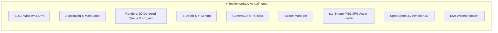

# 🗺️ Roadmap de Desarrollo - Motor de Juegos C++ 2D / 2.5D

Este documento define la hoja de ruta técnica para hacer evolucionar el motor desde un prototipo de renderizado 2.5D hasta un motor de videojuegos completo, modular y listo para producción.

---

## 📊 Estado Actual del Motor

---

## 🚀 Fases del Roadmap

### 📍 Fase 1: Carga de Assets & Renderizado Avanzado (Completado)
> **Objetivo**: Permitir el uso de imágenes reales (PNG/JPG), recortar regiones de textura y soportar animaciones 2D.

- [x] **1.1 Cargador de Imágenes Reales (`stb_image`)**:
  - Integración de `stb_image.h` en `Engine::Texture::load_from_file` para cargar archivos `.png`, `.jpg`, `.bmp`, `.tga`.
- [x] **1.2 Soporte para Sprite Sheets y Animaciones 2D**:
  - `SpriteCommand` extendido con recorte de región `src_rect`.
  - Implementación de `Engine::SpriteSheet` y `Engine::Animation2D` (control de tiempo, FPS, clips y bucles).
- [x] **1.3 Escena Demo de Animación**:
  - `AnimatedSpriteDemoScene` integrada con un personaje con estados *Idle*, *Run* y *Spin*.

---

### 📍 Fase 2: Optimizaciones de Alto Rendimiento (Prioridad Inmediata)
> **Objetivo**: Eliminar los cuellos de botella GPU/CPU para pasar de 3,000 a +100,000 sprites a 60+ FPS estables.

- [ ] **2.1 Sprite Batching / Instancing (Reducción Masiva de Draw Calls)**:
  - Agrupar la geometría de sprites por textura/atlas en un solo buffer de vértices VBO/VAO.
  - Pasar de N llamadas individuales por frame (`SDL_RenderTexture`) a 1-5 Draw Calls por fotograma.
- [ ] **2.2 Frustum Culling 2D (Descarte de Objetos Fuera de Pantalla)**:
  - Verificar si el AABB del sprite interseca con el área visible de la cámara.
  - Descartar objetos fuera de pantalla en $O(1)$ antes de encolar u ordenar en CPU.
- [ ] **2.3 Administrador Centralizado de Recursos (`AssetManager`)**:
  - Sistema de caché con `std::unordered_map<std::string, std::shared_ptr<Texture>>`.
  - Evitar recargas duplicadas en disco y VRAM cuando múltiples entidades comparten la misma imagen.
- [ ] **2.4 Optimización de Memoria RAM & Ordenamiento**:
  - Pre-asignar memoria en la cola de renderizado (`m_sprite_queue.reserve`) para evitar fragmentación del Heap en el bucle principal.
  - Optimizar el algoritmo de ordenamiento por capas $Z/Y$.

---

### 📍 Fase 3: Arquitectura de Entidades & Sistema de Entrada (Medio Plazo)
> **Objetivo**: Desacoplar la lógica del juego del código duro en las escenas mediante componentes y mapeo de controles.

- [ ] **3.1 Sistema de Entrada (Input Manager)**:
  - Crear un sistema de acciones mapeables (`"MoveLeft"`, `"Jump"`, `"Pause"`) para Teclado, Ratón y Gamepads (mandos Xbox/PlayStation).
  - Soporte para eventos de clic y coordenadas del ratón convertidas al mundo 2.5D.
- [ ] **3.2 Sistema de Componentes (ECS o GameObject/Component)**:
  - Integrar la biblioteca **EnTT** o implementar una jerarquía `Entity-Component-System`.
  - Componentes fundamentales: `TransformComponent`, `SpriteComponent`, `CameraComponent`, `ScriptComponent`.

---

### 📍 Fase 4: Física 2D & Sistema de Colisiones (Medio Plazo)
> **Objetivo**: Dotar a los objetos de detección de colisiones, gravedad y respuesta física.

- [ ] **4.1 Motor de Colisiones 2D Ligero (AABB & Círculos)**:
  - Detección de colisiones Caja contra Caja (AABB), Círculo contra Círculo y Raycasting 2D.
  - Generación de eventos de colisión (`on_collision_enter`, `on_trigger_overlap`).
- [ ] **4.2 Integración de Box2D (Opcional / Avanzado)**:
  - Integración opcional de **Box2D v3.0** para simulación de cuerpos rígidos, fricción, restitución y articulaciones.

---

### 📍 Fase 5: Audio, Fuentes & Interfaz de Usuario (Largo Plazo)
> **Objetivo**: Permitir la creación de juegos completos con sonidos, música y UI interactiva.

- [ ] **5.1 Sistema de Audio (`miniaudio` o `SDL_mixer`)**:
  - Reproducción de efectos de sonido (SFX) en memoria y streaming de música de fondo (Ogg/MP3).
  - Control de volumen por canales (Master, Música, SFX) y atenuación posicional 2D.
- [ ] **5.2 Renderizado de Texto & Fuentes (TTF)**:
  - Carga de fuentes `.ttf` o Bitmap Fonts (`SDL_ttf` o `msdf-atlas-gen`).
- [ ] **5.3 UI Framework Ligero**:
  - Componentes de UI: Botones, Barras de vida, Paneles, Texto flotante y Tooltips.

---

### 📍 Fase 6: Herramientas de Depuración & Editor (Avanzado)
> **Objetivo**: Facilitar la depuración y creación de niveles.

- [ ] **6.1 Integración de Dear ImGui**:
  - Overlay de depuración en tiempo real dentro de la ventana del juego:
    - Contador de FPS, métricas de GPU y memoria.
    - Árbol de entidades e inspector de propiedades en vivo.
    - Controles para mover la cámara y modificar la gravedad o profundidad en caliente.
- [ ] **6.2 Carga de Mapas Tiled / LDTK**:
  - Cargador de mapas de baldosas (*tilemaps*) desde editores como Tiled (`.tmx`) o LDTK (`.ldtk`).
