# 🗺️ Roadmap de Desarrollo - Motor de Juegos C++ 2D / 2.5D

Este documento define la hoja de ruta técnica detallada para hacer evolucionar el motor hacia un motor de videojuegos 2D/2.5D modular, de alto rendimiento y listo para producción, con su propio Editor IDE integrado.

---

## 📊 Estado Actual de la Arquitectura

```mermaid
graph TD
    subgraph CoreEngine ["✅ Core Engine & Runtime (Completado)"]
        SDL[SDL3 Window & High-DPI]
        Renderer[Renderer2D Sprite Batching + Culling O1]
        Depth[2.5D Z-Depth & Parallax]
        ECS[ECS EntityManager & Bitmask Signatures]
        Physics[Box2D v3 + Joints + Collision Matrix]
        Particles[ParticleSystem2D Zero-Alloc Pool & Bouncing]
        Events[EventDispatcher Bus]
        Async[ThreadPool & SIMD Optimizations]
        PostFX[PostProcessPipeline Multi-Pass & Volúmenes 2D]
        Camera[CameraController2D Smooth Follow & Trauma Shake]
        FSM[StateMachine & Pushdown Automaton]
        Audio[AudioEngine miniaudio & Ondas Sintetizadas]
        Font[Font stb_truetype & Screen HUD]
        Storage[FileSystem Virtual Mounts & SaveSystem CRC32/Base64]
    end

    subgraph EditorIDE ["✅ Editor IDE Integrado - Fase 8 Base (Completado)"]
        Docking[Dear ImGui Docking & Modern Theme]
        Viewport[Scene Viewport Render Target 16:9 + Controles Transporte]
        Hierarchy[Scene Hierarchy & Buscador de Entidades]
        Inspector[Entity Inspector & Modificador de Componentes]
        Console[ConsolePanel & Terminal CLI en Vivo]
        Metrics[Engine & Metrics Monitor]
        Isolation[Aislamiento de Inputs & Normalización de Cursor 1:1]
    end

    subgraph Upcoming ["🚀 Próximos Módulos Detallados"]
        M5[⭐ Módulo 5: Calibrador de Post-Processing & Gizmos de Transform]
        M6[⭐ Módulo 6: Serialización de Escenas .scene & Asset Browser]
        M7[Módulo 7: Tilemaps LDtk / Tiled & Fusionador de Colisiones]
        M8[Módulo 8: Iluminación 2D Dinámica & Sombras Poligonales]
        M9[Módulo 9: Scripting Runtime Lua & Hot-Reload]
        M10[Módulo 10: Pipeline de Exportación 'Build Standalone Game']
    end

    CoreEngine --> EditorIDE
    EditorIDE --> Upcoming
```

---

## 🏆 Fases Completadas

### 📍 Fase 1 a 7 & 9: Core Engine, Render, Físicas & Audio
- [x] **Renderer2D & Batching SIMD**: 1 sola Draw Call por frame, ordenamiento Radix Sort 64-bit y multihilo.
- [x] **Cámara 2.5D, Parallax & Cinemática**: Profundidad $Z$, *SmoothDamp Follow*, *Deadzone* y *Trauma Shake*.
- [x] **ECS & Bus de Eventos**: `EntityManager` contiguo, firmas bitmask de 64 bits y eventos diferidos.
- [x] **Física Box2D v3 & Partículas**: Matriz de capas de colisión, cuerdas elásticas de Bézier y pool de partículas de cero asignación.
- [x] **Pipeline de Post-Processing**: Shaders modulares multi-pass, volúmenes de interpolación atmosférica y tweens.
- [x] **Audio & Guardado**: Miniaudio multicanal, sintaxis de fuentes TrueType, `SaveSystem` binario con cabecera `E2DS` y CRC32.

### 📍 Fase 8 (Hito Actual): Editor en Vivo & Espacio de Trabajo IDE
- [x] **8.1 Integración de Dear ImGui con Docking Branch**:
  - Ventana host DockSpace, layout persistente (`imgui.ini`), menú superior (*File, Edit, Panels, Build, View, Help*).
  - Tema visual oscuro profesional (*Dark Slate & Indigo Accent*).
  - Corrección de escalado Retina / High-DPI en Mac con alineación pixel-perfect.
- [x] **8.2 `Scene Viewport` Desacoplado**:
  - Render Target Texture offscreen de alta fidelidad `1920x1080` (16:9).
  - Barra de transporte: **Play (▶️)**, **Pause (⏸️)** y **Stop (⏹️)** con control de escala de tiempo.
  - Selector de escenas interactivo en barra superior.
  - Aislamiento de inputs: el juego solo responde cuando el Viewport tiene foco y el usuario no está escribiendo en cuadros de texto.
  - Normalización matemática 1:1 de la posición del ratón en el mundo.
- [x] **8.3 `Scene Hierarchy` (Jerarquía de Escena)**:
  - Lista de entidades vivas en tiempo real, filtro de búsqueda por texto, creación (`+ Add Entity`) y eliminación.
- [x] **8.4 `Entity Inspector` (Inspector de Propiedades)**:
  - Edición en caliente de `TagComponent`, `TransformComponent` (Posición, Rotación, Escala con botón de reset `[R]`), `SpriteComponent` (tamaño, color picker con alfa, Flip X/Y), `RigidBodyComponent` (tipo, masa, gravedad, fricción, restitución) y `ColliderComponent`.
- [x] **8.5 `Console & Logs` (Terminal Interactiva)**:
  - Redirección en vivo de todos los logs del motor con códigos de color e iconos.
  - Filtros por nivel (`Info`, `Warn`, `Error`), búsqueda de texto y terminal CLI con comandos (`help`, `timescale`, `pause`, `resume`, `clear`).
- [x] **8.6 `Engine & Metrics` (Monitor de Rendimiento)**:
  - Gráficas de FPS y frametime en tiempo real.

---

## 🚀 Próximos Módulos Detallados (Hoja de Ruta Activa)

### 📍 Módulo 6: Serialización de Escenas (`.scene`) & Explorador de Assets (✅ Completado)
> **Objetivo**: Eliminar la creación de niveles por código C++ y permitir guardar/abrir escenas creadas visualmente.

- [x] **6.1 `SceneSerializer` (JSON en Disco y en Memoria)**:
  - Serializador y deserializador completo de todas las entidades y componentes del ECS (`Tag`, `Transform`, `Sprite`, `RigidBody`, `Collider`).
  - Serialización a `std::string` en memoria para instantáneas en 0ms.
  - Integración con el menú superior: **`File -> New Scene`**, **`File -> Save Scene`**, **`File -> Save Scene As...`**.
- [x] **6.2 `AssetBrowserPanel` (Explorador de Recursos)**:
  - Panel inferior acoplado con navegador de carpetas (`assets/scenes`, `assets/textures`, `assets/audio`).
  - Doble clic para abrir carpetas y cargar escenas instantáneamente.
  - Menú contextual para crear carpetas, escenas y abrir en el explorador del sistema operativo.
- [x] **6.3 Arquitectura de 2 Fases (Edit Mode vs Play Mode al estilo Unity)**:
  - `Edit Mode`: Cero físicas, cero destrucción y edición estática protegida.
  - `Play Mode`: Snapshot en memoria instantáneo y ejecución dinámica de Box2D.
  - `Stop Mode`: Restauración 100% fiel de la escena original desde memoria.

---

### 📍 Módulo 5: Cámara 2D en Editor, Gizmos Visuales & Calibrador de Post-Processing (✅ Completado)
> **Objetivo**: Navegación libre por el escenario con el ratón, visualización de la cámara de juego y manipulación directa en el visor.

- [x] **5.1 Cámara 2D del Editor (Navegación en Viewport)**:
  - **Pan Libre:** Desplazamiento del visor arrastrando con el botón central o botón derecho del ratón.
  - **Zoom Suave:** Rueda del ratón para acercar / alejar el visor ($0.1\times$ a $5.0\times$).
  - **Botón `Focus on Entity` ('F'):** Centra la cámara del visor sobre la entidad seleccionada.
- [x] **5.2 `Camera2D` Frustum Gizmo (Marco de Cámara de Juego)**:
  - Dibujado del rectángulo/marco (*Frustum Frame*) en el Viewport para ver exactamente qué ve la cámara del juego ($1920\times 1080$).
- [x] **5.3 Gizmos de Transformación & Raycast Picking en Viewport**:
  - Flechas de traslación ($X$ roja, $Y$ verde) y caja central para arrastrar entidades en vivo con el ratón.
  - Clic directo sobre cualquier sprite en el Viewport para seleccionarlo en la Jerarquía y en el Inspector.
- [x] **5.4 `PostProcessTunerPanel`**:
  - Calibrador visual de Bloom, Aberración Cromática, Viñeta, CRT y Grano de Película con guardado/carga de presets JSON.

---

### 📍 Módulo 7 (Siguiente): Tilemaps, Paleta de Baldosas (Pasto/Tierra) & Fusión de Colisiones
> **Objetivo**: Pintar niveles con pasto, tierra, plataformas y generar colisionadores automáticamente.

- [ ] **7.1 Tilemap Component & Tilesets PNG**:
  - Texturas reales en `assets/textures/tiles/` (`grass_top.png`, `dirt_block.png`, `stone_brick.png`, `wood_platform.png`).
  - Renderizado por batching eficiente de grillas de baldosas ($16\times 16$, $32\times 32$, $64\times 64$).
- [ ] **7.2 Tilemap Palette Panel (Pincel de Baldosas)**:
  - Panel para seleccionar baldosas de un tileset y pintarlas con clic en el Viewport (Pincel, Rectángulo, Borrador).
- [ ] **7.3 Fusión de Colisiones (Composite Box2D Colliders)**:
  - Une automáticamente baldosas adyacentes en un solo cuerpo estático Box2D continuo para optimizar físicas y evitar atascos en bordes.

---

### 📍 Módulo 8: Sistema de Deshacer / Rehacer (Undo / Redo - Ctrl+Z / Ctrl+Y)
> **Objetivo**: Historial de comandos en el Editor para revertir y rehacer cualquier acción de diseño.

- [ ] **8.1 Command Pattern & UndoStack**:
  - Pila de comandos con límite configurable (ej. 100 pasos).
  - Acciones atómicas:
    - **`MoveEntityCommand`:** Deshacer/rehacer movimiento con Gizmos o sliders del Inspector.
    - **`CreateEntityCommand` / `DeleteEntityCommand`:** Revertir creación o borrado accidental de entidades.
    - **`ModifyComponentCommand`:** Revertir cambios de color, tamaño, masa o restitución.
- [ ] **8.2 Atajos de Teclado & Menú `Edit`**:
  - **`Ctrl + Z` (Cmd+Z en Mac):** Deshacer (*Undo*).
  - **`Ctrl + Y` / `Ctrl + Shift + Z` (Cmd+Shift+Z en Mac):** Rehacer (*Redo*).
  - Menú superior **`Edit -> Undo`** y **`Edit -> Redo`** con tooltip de la acción a revertir (ej. *"Undo Move Platform_1"*).

---

### 📍 Módulo 9: Iluminación 2D Dinámica & Sombras Poligonales
> **Objetivo**: Iluminación 2D atmosférica con cálculo de penumbras y oclusión de sombras.

- [ ] **9.1 `Light2DComponent` & Render Pass de Luz**:
  - Luces puntuales (*Point Lights*), antorchas y luz ambiental con mezcla multiplicativa en textura offscreen.
- [ ] **9.2 Shadow Casters 2D**:
  - Extrusión de sombras poligonales en GPU a partir de bordes de colliders y geometrías estáticas.

---

### 📍 Módulo 10: Capa de Scripting Runtime (Lua & Hot-Reload)
> **Objetivo**: Escribir comportamientos de juego y lógica de personajes sin recompilar C++.

- [ ] **10.1 Integración de Lua VM / Sol2**:
  - Binding del ECS, inputs, audio y físicas a scripts `.lua`.
  - Componente `ScriptComponent` asignable a cualquier entidad en el Inspector.
  - Recarga en caliente (*Hot-Reloading*) al modificar el archivo `.lua` en disco.

---

### 📍 Módulo 11: Exportador de Proyecto ("Build Standalone Game")
> **Objetivo**: Empaquetar y compilar el juego final en un ejecutable limpio sin editor.

- [ ] **11.1 Pipeline de Exportación**:
  - Menú **`Build -> Build Game Standalone`**.
  - Empaquetado automático de assets y generación del binario final del juego para macOS / Windows / Linux.
