# 🗺️ Roadmap de Desarrollo - Motor de Juegos C++ 2D / 2.5D

Este documento define la hoja de ruta técnica detallada para hacer evolucionar el motor hacia un motor de videojuegos 2D/2.5D modular, de alto rendimiento y listo para producción, con su propio Editor IDE integrado.

---

## 📊 Estado Actual de la Arquitectura

```mermaid
graph TD
    subgraph CoreEngine ["✅ Core Engine & Runtime (Completado)"]
        SDL[SDL3 Window & High-DPI]
        Renderer[Renderer2D Sprite Batching + Culling O1]
        Depth[2.5D Z-Depth & Parallax]
        ECS[ECS EntityManager & Bitmask Signatures]
        Physics[Box2D v3 + Joints + Collision Matrix]
        Particles[ParticleSystem2D Zero-Alloc Pool & Bouncing]
        Events[EventDispatcher Bus]
        Async[ThreadPool & SIMD Optimizations]
        PostFX[PostProcessPipeline Multi-Pass & Volúmenes 2D]
        Camera[CameraController2D Smooth Follow & Trauma Shake]
        FSM[StateMachine & Pushdown Automaton]
        Audio[AudioEngine miniaudio & Ondas Sintetizadas]
        Font[Font stb_truetype & Screen HUD]
        Storage[FileSystem Virtual Mounts & SaveSystem CRC32/Base64]
    end

    subgraph EditorIDE ["✅ Editor IDE Integrado - Fase 8 Base (Completado)"]
        Docking[Dear ImGui Docking & Modern Theme]
        Viewport[Scene Viewport Render Target 16:9 + Controles Transporte]
        Hierarchy[Scene Hierarchy & Buscador de Entidades]
        Inspector[Entity Inspector & Modificador de Componentes]
        Console[ConsolePanel & Terminal CLI en Vivo]
        Metrics[Engine & Metrics Monitor]
        Isolation[Aislamiento de Inputs & Normalización de Cursor 1:1]
    end

    subgraph Upcoming ["🚀 Próximos Módulos Detallados"]
        M5[⭐ Módulo 5: Calibrador de Post-Processing & Gizmos de Transform]
        M6[⭐ Módulo 6: Serialización de Escenas .scene & Asset Browser]
        M7[Módulo 7: Tilemaps LDtk / Tiled & Fusionador de Colisiones]
        M8[Módulo 8: Iluminación 2D Dinámica & Sombras Poligonales]
        M9[Módulo 9: Scripting Runtime Lua & Hot-Reload]
        M10[Módulo 10: Pipeline de Exportación 'Build Standalone Game']
    end

    CoreEngine --> EditorIDE
    EditorIDE --> Upcoming
```

---

## 🏆 Fases Completadas

### 📍 Fase 1 a 7 & 9: Core Engine, Render, Físicas & Audio
- [x] **Renderer2D & Batching SIMD**: 1 sola Draw Call por frame, ordenamiento Radix Sort 64-bit y multihilo.
- [x] **Cámara 2.5D, Parallax & Cinemática**: Profundidad $Z$, *SmoothDamp Follow*, *Deadzone* y *Trauma Shake*.
- [x] **ECS & Bus de Eventos**: `EntityManager` contiguo, firmas bitmask de 64 bits y eventos diferidos.
- [x] **Física Box2D v3 & Partículas**: Matriz de capas de colisión, cuerdas elásticas de Bézier y pool de partículas de cero asignación.
- [x] **Pipeline de Post-Processing**: Shaders modulares multi-pass, volúmenes de interpolación atmosférica y tweens.
- [x] **Audio & Guardado**: Miniaudio multicanal, sintaxis de fuentes TrueType, `SaveSystem` binario con cabecera `E2DS` y CRC32.

### 📍 Fase 8 (Hito Actual): Editor en Vivo & Espacio de Trabajo IDE
- [x] **8.1 Integración de Dear ImGui con Docking Branch**:
  - Ventana host DockSpace, layout persistente (`imgui.ini`), menú superior (*File, Edit, Panels, Build, View, Help*).
  - Tema visual oscuro profesional (*Dark Slate & Indigo Accent*).
  - Corrección de escalado Retina / High-DPI en Mac con alineación pixel-perfect.
- [x] **8.2 `Scene Viewport` Desacoplado**:
  - Render Target Texture offscreen de alta fidelidad `1920x1080` (16:9).
  - Barra de transporte: **Play (▶️)**, **Pause (⏸️)** y **Stop (⏹️)** con control de escala de tiempo.
  - Selector de escenas interactivo en barra superior.
  - Aislamiento de inputs: el juego solo responde cuando el Viewport tiene foco y el usuario no está escribiendo en cuadros de texto.
  - Normalización matemática 1:1 de la posición del ratón en el mundo.
- [x] **8.3 `Scene Hierarchy` (Jerarquía de Escena)**:
  - Lista de entidades vivas en tiempo real, filtro de búsqueda por texto, creación (`+ Add Entity`) y eliminación.
- [x] **8.4 `Entity Inspector` (Inspector de Propiedades)**:
  - Edición en caliente de `TagComponent`, `TransformComponent` (Posición, Rotación, Escala con botón de reset `[R]`), `SpriteComponent` (tamaño, color picker con alfa, Flip X/Y), `RigidBodyComponent` (tipo, masa, gravedad, fricción, restitución) y `ColliderComponent`.
- [x] **8.5 `Console & Logs` (Terminal Interactiva)**:
  - Redirección en vivo de todos los logs del motor con códigos de color e iconos.
  - Filtros por nivel (`Info`, `Warn`, `Error`), búsqueda de texto y terminal CLI con comandos (`help`, `timescale`, `pause`, `resume`, `clear`).
- [x] **8.6 `Engine & Metrics` (Monitor de Rendimiento)**:
  - Gráficas de FPS y frametime en tiempo real.

---

## 🚀 Próximos Módulos Detallados (Hoja de Ruta Activa)

### 📍 Módulo 5: Calibrador de Post-Processing & Gizmos de Transform en Viewport
> **Objetivo**: Poder editar y ajustar visualmente el juego directamente dentro del visor y ajustar la estética sin tocar código.

- [ ] **5.1 `PostProcessTunerPanel`**:
  - Panel desacoplado con controles deslizantes para calibrar en vivo:
    - *Bloom:* Umbral (*Threshold*), Intensidad y Radio de difusión.
    - *Chromatic Aberration:* Separación de canales RGB en píxeles.
    - *Vignette:* Radio, Suavidad y Color.
    - *CRT & Scanlines:* Densidad de líneas y distorsión de tubo.
    - *Film Grain & Color Grading:* Exposición, Contraste, Saturación y Tinte.
  - Guardado/Carga de presets en formato `.json` a la carpeta `assets/presets/`.
- [ ] **5.2 Gizmos de Transformación 2D en el Viewport**:
  - Al seleccionar una entidad en la Jerarquía o Viewport, dibujar el Gizmo de traslación (flechas X/Y roja y verde).
  - Posibilidad de hacer clic y arrastrar entidades en el visor con el ratón.
  - Selección de entidades por clic directo (*Raycast Entity Picking*).

---

### 📍 Módulo 6: Serialización de Escenas (`.scene`) & Explorador de Assets
> **Objetivo**: Eliminar la creación de niveles por código C++ y permitir guardar/abrir escenas creadas visualmente.

- [ ] **6.1 `SceneSerializer` (JSON & Binario)**:
  - Serializador y deserializador completo de todas las entidades y componentes del ECS.
  - Integración con el menú superior:
    - **`File -> New Scene` (Ctrl+N):** Crea una escena en blanco lista para editar.
    - **`File -> Save Scene` (Ctrl+S):** Serializa las entidades al archivo `.scene`.
    - **`File -> Open Scene` (Ctrl+O):** Carga un archivo `.scene` e instancia sus entidades en el Viewport.
- [ ] **6.2 `AssetBrowserPanel` (Explorador de Recursos)**:
  - Panel inferior acoplado con navegador de carpetas (`assets/textures`, `assets/scenes`, `assets/audio`).
  - Miniaturas de archivos y soporte para arrastrar texturas directamente al Inspector para cambiar sprites.

---

### 📍 Módulo 7: Importación de Tilemaps (LDtk / Tiled) & Colisiones Optimizadas
> **Objetivo**: Construir niveles gigantescos rápidamente con herramientas estándar de la industria.

- [ ] **7.1 Parser de Tilemaps LDtk / Tiled (`.ldtk` / `.json`)**:
  - Carga de capas de tiles, autotiling y capas de objetos decorativos.
  - Renderizado optimizado por chunks para mapas de gran escala.
- [ ] **7.2 Fusión Automática de Colisiones (*Collision Merging*)**:
  - Agrupación automática de tiles sólidos continuos en una sola caja/polígono de Box2D para máximo rendimiento.

---

### 📍 Módulo 8: Iluminación 2D Dinámica & Sombras Poligonales
> **Objetivo**: Iluminación 2D atmosférica con cálculo de penumbras y oclusión de sombras.

- [ ] **8.1 `Light2DComponent` & Render Pass de Luz**:
  - Luces puntuales (*Point Lights*), antorchas y luz ambiental con mezcla multiplicativa en textura offscreen.
- [ ] **8.2 Shadow Casters 2D**:
  - Extrusión de sombras poligonales en GPU a partir de bordes de colliders y geometrías estáticas.

---

### 📍 Módulo 9: Capa de Scripting Runtime (Lua & Hot-Reload)
> **Objetivo**: Escribir comportamientos de juego y lógica de personajes sin recompilar C++.

- [ ] **9.1 Integración de Lua VM / Sol2**:
  - Binding del ECS, inputs, audio y físicas a scripts `.lua`.
  - Componente `ScriptComponent` asignable a cualquier entidad en el Inspector.
  - Recarga en caliente (*Hot-Reloading*) al modificar el archivo `.lua` en disco.

---

### 📍 Módulo 10: Exportador de Proyecto ("Build Standalone Game")
> **Objetivo**: Empaquetar y compilar el juego final en un ejecutable limpio sin editor.

- [ ] **10.1 Pipeline de Exportación**:
  - Menú **`Build -> Build Game Standalone`**.
  - Empaquetado automático de assets y generación del binario final del juego para macOS / Windows / Linux.
