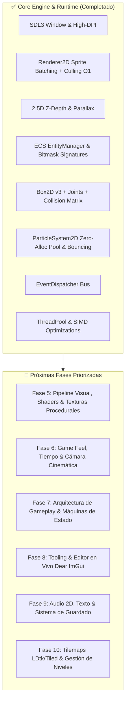

# 🗺️ Roadmap de Desarrollo - Motor de Juegos C++ 2D / 2.5D

Este documento define la hoja de ruta técnica para hacer evolucionar el motor hacia un motor de videojuegos 2D/2.5D modular, de alto rendimiento y listo para producción.

---

## 📊 Estado Actual de la Arquitectura

---

## 🏆 Fases Completadas

### 📍 Fase 1: Carga de Assets & Renderizado 2.5D (Completado)
- [x] **Cargador de Imágenes Reales (`stb_image`)**: Carga de `.png`, `.jpg`, `.bmp`, `.tga` a texturas GPU.
- [x] **Sprite Sheets y Animaciones 2D**: `SpriteSheet` y `Animation2D` con control de FPS, clips y bucles.
- [x] **Cámara 2.5D & Parallax**: Profundidad $Z$, escalado focal y desplazamiento de capas de fondo.

### 📍 Fase 2: Optimizaciones de Rendimiento Extremo (Completado)
- [x] **Sprite Batching**: Agrupación de quads por textura vía `SDL_RenderGeometry` (1 sola Draw Call por frame).
- [x] **Frustum Culling 2D**: Descarte en $O(1)$ (`Camera2D::is_visible`) para objetos fuera del viewport.
- [x] **Gestor de Recursos (`AssetManager`)**: Caché centralizada para evitar duplicación en RAM/VRAM.
- [x] **Vectorización SIMD & Multihilo**: Aceleración ARM NEON / SSE2 y batching paralelo con `ThreadPool`.

### 📍 Fase 3: Arquitectura ECS & Bus de Eventos (Completado)
- [x] **Sistema de Entidades & Componentes (`EntityManager`)**: Firmas bitmask de 64 bits, vistas de exclusión, hooks de ciclo de vida (`on_construct`, `on_destroy`).
- [x] **Bus de Eventos (`EventDispatcher`)**: Comunicación desacoplada síncrona y diferida por fotograma.
- [x] **Mapeo de Controles (`InputManager`)**: Teclado, ratón y proyección de puntero a coordenadas de mundo.

### 📍 Fase 4: Físicas 2D, Joints & Sistema de Partículas (Completado)
- [x] **Física Box2D v3 Integrada (`PhysicsSystem`)**: Cuerpos estáticos/dinámicos, fricción, restitución y raycasts.
- [x] **Matriz de Capas de Colisión**: Bitmasking por categorías (`PLAYER`, `GROUND`, `COIN`, `HAZARD`, `PROJECTILE`).
- [x] **Articulaciones & Cuerdas Elásticas**: Soporte de `JointType::Rope` con deformación de catenaria por curvas de Bézier.
- [x] **Motor de Partículas Nativo (`ParticleSystem2D`)**: Pool circular de cero asignaciones en memoria, rebote físico contra el terreno y texturas procedurales suaves (soft-circle y diamond-spark).
- [x] **Presets Desacoplados (`Engine::Presets`)**: Recetas de gameplay (explosiones, chispas, monedas, polvo) aisladas del núcleo del motor en `src/particles/ParticlePresets.hpp`.

---

## 🚀 Próximas Fases (Hoja de Ruta Activa)

### 📍 Fase 5: Pipeline Visual, Shaders & Texturas Procedurales
> **Objetivo**: Elevar la calidad visual con post-processing en GPU, efectos de shader y generación matemática de texturas sin dependencias externas.

- [x] **5.1 Texturas Procedurales Parametrizadas (`ProceduralTextureDesc`)**:
  - Generador matemático agnóstico: `NoiseGradient` (Perlin/Simplex fBm), `Voronoi` (celdas orgánicas), `LinearGradient`, `RadialGradient`, `Checkerboard` y `Custom`.
  - Estructura serializable (`seed`, `scale`, `octaves`, `color_a`, `color_b`) para conectar a editores o crear terrenos variados sin patrones repetitivos.
- [x] **5.2 Pipeline de Render Targets & Post-Processing (`PostProcessPipeline`)**:
  - Renderizado a textura intermedia con búferes Ping-Pong en VRAM (`SDL_TEXTUREACCESS_TARGET`).
  - Cadena extensible de pases abstractos (`IPostProcessPass`): Viñeteado radial, Aberración cromática RGB y Destello de pantalla/daño.
- [x] **5.3 Evolución Profesional de Post-Processing & Shaders GPU**:
  - *Fragment Shaders Reales*: Bloom de alta intensidad, Blur Gaussiano separable (pase horizontal/vertical), Film Grain, Color Grading LUT y simulación CRT/Scanlines a nivel de píxel.
  - *Cadena de Downsampling / Mip-chain*: Render targets auxiliares a 1/2 y 1/4 de resolución para optimización de efectos densos (Bloom / Glow ambiental).
  - *Volúmenes de Post-Proceso 2D (`PostProcessVolume`)*: Triggers espaciales en escena con interpolación suave (*lerp/blend*) de parámetros al entrar a zonas (cuevas oscuras, bajo el agua, fuego).
  - *Presets & Serialización JSON*: Exportación e importación de perfiles completos de post-proceso (`presets/underwater.json`, `presets/retro_crt.json`).
  - *Sistema de Tweens & Event FX*: Abstracción unificada de curvas de easing para disparadores de impacto/daño sin duplicar lógica de tiempo.
- [x] **5.4 Efectos de Shaders de Materiales / Sprites**:
  - *Outline & Glow* (resaltado de siluetas de objetos seleccionables o coleccionables mediante `SpriteComponent`).
  - *Hit Flash* / *Screen Flash* (destello reactivo ante daño o detonaciones).
- [x] **5.5 Iluminación 2D Dinámica Básica**:
  - Luces puntuales 2D (*Point Lights*) con radio, color, intensidad y mezcla multiplicativa con mapa de sombras/ambiente (demostrado en la hoguera con titilación sinusoidal).

---

### 📍 Fase 6: Game Feel, Tiempo & Cámara Cinemática
> **Objetivo**: Pulir la sensación de juego (*Game Juice*), control del tiempo e independizar la interfaz de usuario.

- [x] **6.1 Gestión de Tiempo Global (`Engine::Time`)**:
  - `set_time_scale(scale)`: Pausa limpia (`0.0f`), cámara lenta (*Bullet Time*) o avance rápido.
  - `delta_time_clamping`: Prevención de atravesar geometrías por caídas de FPS (*spiral of death*).
  - Métodos puros del motor: `get_delta_time()`, `get_real_delta_time()`, `get_time()`, `get_frame_count()`.
- [x] **6.2 Renderizado en Espacio de Pantalla (`Screen-Space HUD / Canvas`)**:
  - `Renderer2D::submit_screen_sprite()` con Bit 63 de prioridad en Sort Key para garantizar ordenamiento sobre el mundo.
  - Ignora la traslación y zoom de la cámara para HUDs, contadores de monedas y menús de pausa fijos en pantalla.
- [ ] **6.3 Controlador de Cámara Cinemático (*Camera Director*)**:
  - Seguimiento suavizado (*SmoothDamp / Lerp Follow*) con zona muerta (*Deadzone*).
  - *Lookahead*: Anticipación de cámara en la dirección de carrera del personaje.
  - *Camera Bounds*: Restricción de límites para no mostrar zonas vacías fuera del nivel.
  - *Trauma Screen Shake*: Decaimiento no lineal de vibración de cámara (impactos, explosiones).

---

### 📍 Fase 7: Arquitectura de Gameplay & Máquinas de Estado
> **Objetivo**: Estructurar la lógica de personajes y enemigos de forma modular y escalable.

- [ ] **7.1 Máquina de Estados Finitos Genérica (`StateMachine<T>`)**:
  - Patrón de estados fuertemente tipado con métodos `enter()`, `update()`, `exit()`.
  - Eliminación de flags booleanos masivos en personajes.
- [x] **7.2 Máquina de Estados de Animación**:
  - Conexión automática entre el estado lógico del personaje (*Idle, Run, Jump, Fall, Grapple*) y sus clips en `Animation2D`.
  - Inversión horizontal en GPU (*Flip X*) y anclaje de spritesheet por celda.

---

### 📍 Fase 8: Herramientas de Depuración & Editor en Vivo
> **Objetivo**: Permitir la inspección, calibración y edición en tiempo real dentro del viewport sin recompilar código.

- [ ] **8.1 Integración de Dear ImGui en SDL3**:
  - Renderizado del backend ImGui acoplado al loop de `Engine::Application`.
- [ ] **8.2 Inspector de Entidades & ECS en Vivo**:
  - Panel lateral con jerarquía de entidades activas, desglose de componentes y edición de valores (velocidad, masa, posición, tintes).
- [ ] **8.3 Inspector & Stack de Post-Processing en Vivo**:
  - Reflexión e inspección visual con `virtual void on_gui()` por pase (sliders de intensidad, color pickers, curvas).
  - *Pass Factory & Hot Reload*: Añadir, remover, reordenar y alternar pases en caliente desde el menú de la UI.
  - Gestor de presets visuales integrado en la GUI (Cargar/Guardar perfiles en disco con 1 clic).
- [ ] **8.4 Debug Viewers & Sintonizadores**:
  - Renderizado de colliders y cajas de colisión (AABB / círculos / raycasts).
  - Sintonizador de partículas en vivo (sliders de tamaño, gravedad, velocidad y color).
  - Monitor de rendimiento (gráfico de frametime, llamadas a GPU, conteo de entidades vivas).
- [ ] **8.5 Consola de Logs Filtrable & Barra de Herramientas Flotante (`F1` / `~`)**:
  - Ventana de depuración interactiva superpuesta al viewport sin interferir con el gameplay.
  - Consola con filtrado por categorías mediante checkboxes (*Physics/Pos, Raycasts, Volúmenes, Post-Processing, General*), niveles de severidad y auto-scroll.
  - Sintonizador de físicas en tiempo real (gravedad, escala de tiempo) y selector rápido de escenas activas.

---

### 📍 Fase 9: Sistema de Audio, Texto & Guardado de Partida
> **Objetivo**: Dotar al motor de sonido espacializado, tipografía nítida y persistencia de datos.

- [ ] **9.1 Sistema de Audio (`miniaudio`)**:
  - Wrapper ligero y multiplataforma con `miniaudio.h`.
  - Canales separados: *Master*, *Music* (streaming de pistas en loop) y *SFX* (efectos en memoria).
  - Atenuación de sonido 2D posicional según la distancia a la cámara o jugador.
- [ ] **9.2 Renderizado de Texto & Fuentes Tipográficas**:
  - Carga y rasterización de fuentes TrueType (`.ttf` / `.otf`).
  - Soporte de texto con alineación, color, escala y renderizado a través de quads batchados en `Renderer2D`.
- [ ] **9.3 Sistema de Guardado & Configuración (`SaveSystem / PlayerPrefs`)**:
  - Persistencia de opciones (volumen, resolución, pantalla completa, keybindings).
  - Guardado de partida y checkpoints en formato binario/JSON.

---

### 📍 Fase 10: Importación de Niveles & Serialización
> **Objetivo**: Crear niveles visualmente ricos mediante herramientas estándar de la industria.

- [ ] **10.1 Cargador de Mapas LDtk / Tiled**:
  - Parseo de archivos de nivel `.ldtk` o `.json`/`.tmx`.
  - Generación automática de capas de tiles, entidades decorativas y colliders estáticos de Box2D.
- [ ] **10.2 Serialización de Escenas (JSON/YAML)**:
  - Guardado y carga de entidades y componentes a archivo de configuración de nivel.
